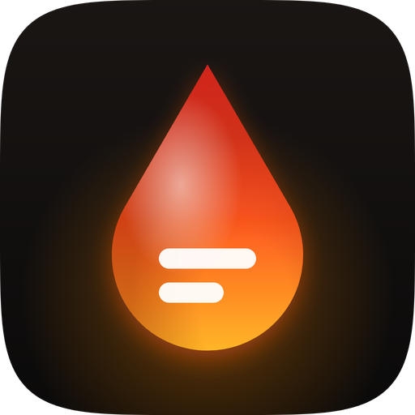
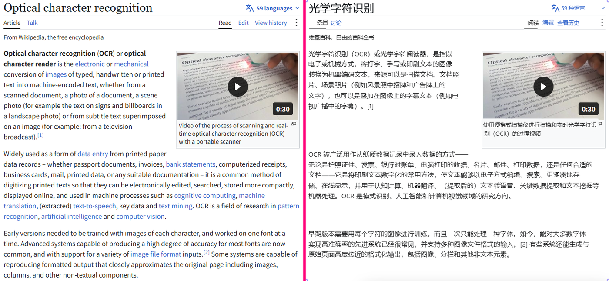
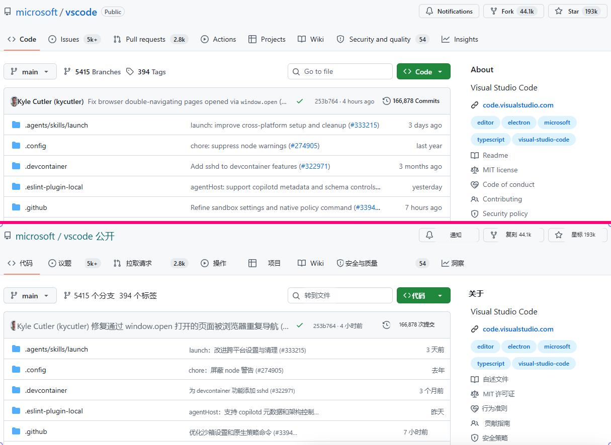
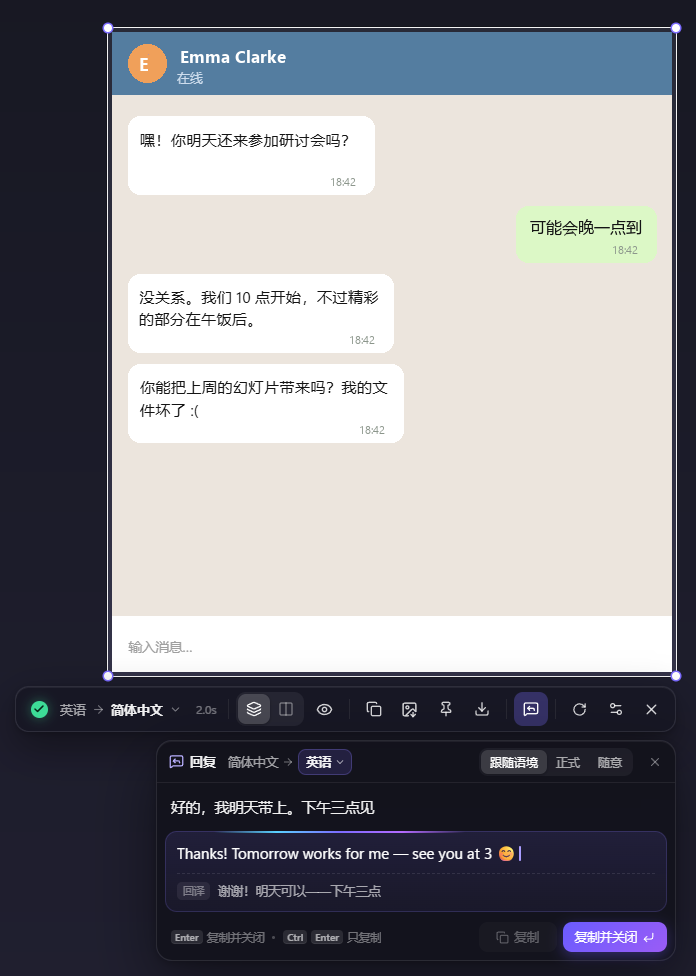
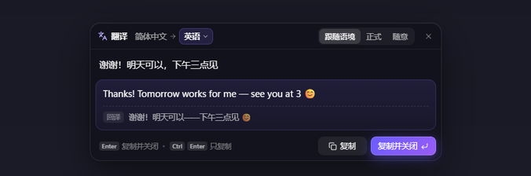
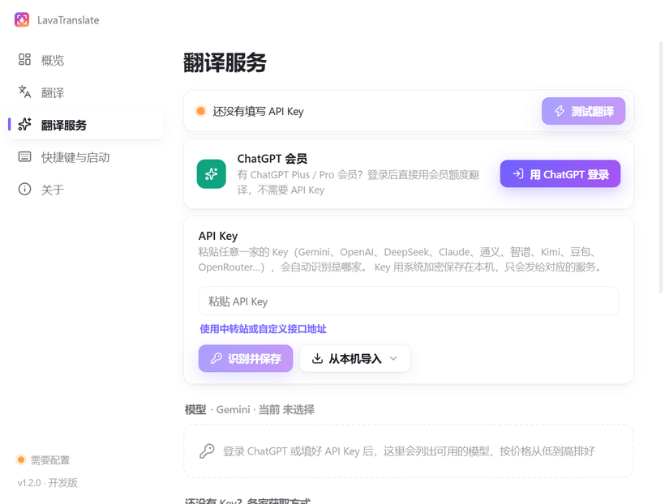

<p align="center">
  
</p>

<h1 align="center">LavaTranslate</h1>

<p align="center">
  <b>Select any part of your screen — the translation appears right on top of it, in the same layout.</b><br>
  Then answer foreign-language chats in your own language.
</p>

<p align="center">
  <a href="https://github.com/chengcczzjj/LavaTranslate/releases/latest"></a>
  <a href="https://github.com/chengcczzjj/LavaTranslate/releases"></a>
</p>

<p align="center"><b>English</b> · <a href="README.zh-CN.md">简体中文</a></p>

<p align="center">Windows x64 · Android arm64 · macOS preview for Apple Silicon</p>

---



## Download and install

| Platform | Download | First translation |
| --- | --- | --- |
| Windows 10/11 · x64 | [Windows installer (.exe), v1.4.7](https://github.com/chengcczzjj/LavaTranslate/releases/download/v1.4.7/LavaTranslate-Setup-1.4.7.exe) | Press **Win + Space** and drag over text to recognize it. Double-click the tray icon to configure a translation service. |
| Android 10+ · arm64 | [Android APK, v1.4.7](https://github.com/chengcczzjj/LavaTranslate/releases/download/v1.4.7/LavaTranslate-Android-1.4.7.apk) | Open the app and add an API key. On Android 11+, enable LavaTranslate under Accessibility. Tap the app icon, then **Translate**. On Android 10, use screen sharing. |
| macOS · Apple Silicon (M-series) | [Build the preview from source](#macos-development-preview) | Open **Settings** from the menu bar and configure a service. Press **Option + Space**, grant Screen Recording permission, then drag over the text. |

The Windows installer is unsigned. If SmartScreen shows **Unknown publisher**, use **More info → Run anyway** after checking that the file came from the release linked above.

### Recent changes

- **Windows and Android 1.4.7** improve vertical speech-bubble layout, rotate whole lines for horizontal target languages, and balance columns while preserving words. Windows also fixes vertical OCR and speeds up CPU recognition; the Mac preview source includes those desktop fixes. [Release notes](docs/releases/v1.4.7.md)
- **Windows 1.4.6** fixes the extra click previously needed to scroll after capture. Translation progress now appears only when a translation starts. [Release notes](docs/releases/v1.4.6.md)
- **Windows 1.4.5** lets you turn off automatic translation, copy the recognized text and skip translation when the selection is already in the target language. Hold Space to scroll the underlying app with the selection border visible. [Release notes](docs/releases/v1.4.5.md)
- **Windows 1.4.4** bundles the Microsoft VC++ x64 runtime that LavaTranslate and its OCR engine need to start. This addresses startup failures on PCs where the runtime is missing or outdated. If initialization still fails, a dialog shows the error and the log location. [Release notes](docs/releases/v1.4.4.md)
- **Windows 1.4.3** uses **Win + Space** once for a screenshot and twice for typed translation. While LavaTranslate is running, this takes over the Windows input-language shortcut. To keep using it for language switching, choose another capture shortcut in **Settings → General**. Upgrades migrate the old **Alt + Q** default and preserve other custom shortcuts. [Release notes](docs/releases/v1.4.3.md)
- **Windows 1.4.2** keeps long translations from covering neighboring captions, columns and icons. If the translation still cannot fit, hover over the ellipsis to read the whole block, or use the side-by-side view or copy action for the full text. [Release notes](docs/releases/v1.4.2.md)
- **Windows and Android 1.4.1** added a target-language picker to replies and typed translation. On Windows, new pins land in the top-left corner and can show either the original or the translation. [Release notes](docs/releases/v1.4.1.md)

## macOS (development preview)

The preview app has been built and opened on an Apple Silicon Mac. Local OCR (CPU) and the settings window have been checked. The full capture-to-translation flow and alignment across multiple displays still need testing on Mac hardware. GitHub Releases has no Mac installer yet.

To try it, clone this repository on an Apple Silicon Mac, open its directory and use native arm64 Node.js 22.18 or later:

```bash
npm ci
npm run models
npm run dev
```

On first capture, allow **Screen & System Audio Recording** under **System Settings → Privacy & Security** for Electron in development or LavaTranslate in a packaged build. Quit and reopen the app if prompted. **Input Monitoring** is only needed to hold Space and interact with the app beneath the translation.

To build a local app, run `npm run pack:mac`. To build a DMG and ZIP, run `npm run dist:mac`. Preview builds are ad-hoc signed, have no Apple notarization and are updated manually. [Mac setup and troubleshooting guide (Chinese)](docs/MACOS.md)

## Why LavaTranslate

Most screenshot translators show a list of sentences in a separate window, so you have to match each one back to the screen. LavaTranslate puts every translated line **exactly where the original was**:

- **Same position, size, color, weight and alignment.** Each line keeps its font size (measured from the actual stroke height), text color (robust to ClearType fringes), bold or regular weight, and left/center/right alignment. Paragraphs that wrap around images keep their shape.
- **Icons stay visible.** Arrows, stars, list numbers and other icons that OCR mistakes for letters are not painted over.
- **The model looks at the screenshot itself.** OCR runs locally; a vision model then fixes recognition errors, merges wrapped lines into paragraphs, and leaves code, commands, URLs, @handles and brand names untranslated.
- **Translations appear block by block.** Windows tries DirectML for local OCR and falls back to the CPU. The Mac preview uses CPU OCR.



## Reply assistant

You can read the other person's message now — LavaTranslate also helps you answer it.



- When the screenshot is a **chat, DM, comment thread or email**, a reply box opens under the toolbar after the translation finishes. Press <kbd>R</kbd> to open it anytime.
- Type in your own language. It starts translating after a short pause. **Auto** translates into the language detected on screen; open the language menu to pick any other language instead (your choice holds until you take a new screenshot).
- Pick a tone: **Match the conversation**, **Formal** or **Casual**. The model reads the conversation on screen to get the wording and form of address right.
- A **back-translation** below the result shows you what you are actually sending.
- <kbd>Enter</kbd> copies and closes so you can paste straight into the chat. **Ctrl + Enter** (Mac: **Command + Enter**) copies and keeps the reply box open. **Shift + Enter** adds a new line, and **↑ / ↓** recall previous replies.

<br clear="right">

## Type to translate

Press your capture shortcut **twice** to translate typed text. The defaults are **Win + Space** on Windows and **Option + Space** on Mac. Translation starts after a pause of about two seconds, or immediately when you press <kbd>Enter</kbd>. **Auto** translates between your interface language and the foreign language you last used. Choose a language from the menu to translate everything you type into that language. LavaTranslate remembers your choice. When the translation is ready, <kbd>Enter</kbd> copies it and closes the window.



## Android

Install the APK linked under [Download and install](#download-and-install), then follow the setup prompts for your Android version.

- **Turn it on once.** (Android 11+, recommended.) After you enable LavaTranslate under Accessibility, it needs no overlay permission, no screen-sharing prompt each time and no persistent notification, and it's ready again after a reboot.
- **The app icon opens a floating panel.** Tap the LavaTranslate icon and a frosted-glass bar drops down from the top of the screen (Translate / Reply / Settings, close on the right); drag it up or down. The Quick Settings tiles "翻译屏幕 (Translate screen)" and "快捷回复 (Quick reply)" work too.
- **Full-screen translation.** Tap Translate: the bar slides away, a small capsule appears at the screen edge, and the whole screen is translated in place over the original, keeping its layout. **Keep scrolling and tapping the app as usual**: the translation lets your touches through and steps aside the moment your finger lands; **when the app stops scrolling or changes page, the new screen is translated automatically** (a tap that changes nothing just brings the translation back). Text you have already seen is cached and shows up instantly.
- **The capsule** stays on top of the translation: **hold Compare (the eye) to see the original**, let go for the translation; Reply opens the reply box; Exit returns to the panel. While the translation is out of the way, its first button translates again right away.
- **Reply assistant.** Write in your own language and get it in the language of the conversation on screen, with a back-translation. Reply on the panel (or the Quick reply tile) translates whatever you type.
- Ordinary app screens are read as text directly (faster and more accurate); text in games and images is recognized on the phone. Only the screen content goes to the translation service you configured.
- **Easy on the battery.** Nothing runs while you're not translating: no screen capture, no network, no UI events. The translation interface and the text-recognition model load on demand and are released 3 minutes after use (or when the screen turns off).
- **Fallback.** On Android 10, or if you'd rather not use Accessibility, switch to "截屏授权 (screen sharing)": a floating button in an overlay window plus Android's screen-sharing permission (granted again after the phone is locked or after a few idle minutes, with a persistent notification).
- **In-app updates.** New versions are announced in the app, downloaded on Wi-Fi, and installed with one tap.

## Setup: sign in with ChatGPT, or bring any API key

On Windows, double-click the tray icon. On Mac, choose **Settings** from the menu bar icon. Open **Translation service** to connect your account or add your own key. The desktop interface follows your system language by default and offers 12 languages under **Settings → General**.

- **ChatGPT Plus / Pro** — click **用 ChatGPT 登录 (Sign in with ChatGPT)**. Translations use your plan's usage instead of an API key. This is OpenAI's official "use your ChatGPT plan" sign-in for open-source apps.
- **Any API key** — paste it and click **识别并保存 (Detect & save)**. LavaTranslate recognizes the provider from the key's format (`AIza…` Gemini, `sk-ant-…` Claude, `sk-or-…` OpenRouter, `sk-proj-…` OpenAI, Zhipu and Doubao formats), or by trying it against DeepSeek, OpenAI, Qwen and Kimi. If it still can't tell, it asks you to pick. For relays and local servers, also fill in the endpoint URL.

Then pick a model (sorted by estimated cost per 1,000 screenshots) and click **测试翻译 (Test)**. Every key you add is kept, and the saved services appear as chips you can switch between. Each provider has step-by-step instructions and a link to its key page at the bottom of the page.



**Providers**

| Provider | Get a key | Good fast models | Notes |
| --- | --- | --- | --- |
| ChatGPT Plus / Pro | Sign in — no key | `gpt-6-luna` | Uses your plan's usage. |
| Gemini | [Google AI Studio](https://aistudio.google.com/apikey) | `gemini-3.5-flash-lite` | Free tier; free-tier data may be used by Google. Needs a proxy in mainland China. |
| OpenAI | [OpenAI Platform](https://platform.openai.com/api-keys) | `gpt-6-luna`, `gpt-5-mini` | ChatGPT plans don't include API credit. |
| DeepSeek | [DeepSeek Platform](https://platform.deepseek.com/api_keys) | `deepseek-flash` | Reads images, ~1 s to first token, half price off-peak. |
| Qwen (Alibaba Cloud) | [Model Studio](https://bailian.console.aliyun.com/?tab=model#/api-key) | `qwen3.8-flash` | Free quota for new users. |
| Zhipu GLM | [BigModel](https://bigmodel.cn/usercenter/proj-mgmt/apikeys) | `glm-4.6v-flash` | Free vision model (one request at a time). |
| Kimi | [Kimi Platform](https://platform.kimi.com/console/api-keys) | | |
| Doubao (Volcano Engine) | [Ark console](https://console.volcengine.com/ark/region:ark+cn-beijing/apiKey) | `doubao-seed-2.0-mini` | Free quota for new users. |
| Claude | [Claude Console](https://platform.claude.com/settings/keys) | `claude-haiku-4-5` | API key only — Anthropic doesn't allow third-party apps to use Claude Pro/Max logins. Called through Anthropic's OpenAI-compatible endpoint. |
| OpenRouter | [OpenRouter](https://openrouter.ai/settings/keys) | | One key for many vendors. |
| Custom | — | | Any OpenAI-compatible endpoint: relays, Ollama, LM Studio… |

LavaTranslate asks every model to skip "thinking" (each provider's own switch, falling back automatically), which makes translation 2–4× faster on models such as DeepSeek V4 Flash and GLM Flash. Models without image input still work: they translate from the OCR text alone, so they can't correct OCR mistakes. On the Custom provider, **从本机导入 (Import from this PC)** can fill in a key from Codex or CC Switch.

## Shortcuts

| Desktop action | Windows | macOS preview |
| --- | --- | --- |
| Start a capture | **Win + Space** or click the tray icon | **Option + Space** or choose **Translate screenshot** from the menu bar icon |
| Translate typed text | Press the capture shortcut twice | Press the capture shortcut twice |
| Open Settings | Double-click the tray icon | Menu bar icon → **Settings**, or **⌘ ,** while the app is active |
| Show the original while held | Alt | Option |
| Copy all translations / all original text | Ctrl + C / Alt + C | ⌘ C / Option + C |
| Copy / save the translated image | Ctrl + Shift + C / Ctrl + S | ⌘ Shift C / ⌘ S |
| Pin the translation / original | F3 / Alt + F3 | ⌘ T / Option + ⌘ T |
| Translate the selection again | Ctrl + R | ⌘ R |

On either desktop, drag to select a region, or click to select a window. Drag the selection or its handles to move or resize it. Hold **Space** to interact with the app underneath, then release to capture the same area again.

- **Tab** switches between in-place and side-by-side views. **R** opens the reply assistant.
- Click a block to copy its translation. **Enter** copies all translations and closes. Double-click the selection to copy it as an image and close. Hold **Alt** (Mac: **Option**) while double-clicking to copy the original image.
- Drag a pin to move it, scroll to zoom and double-click to close. Choose **Always on top** in the pin toolbar to keep it above other windows.
- Right-click or press **Esc** to exit the capture.

## Privacy

- OCR runs on your device. Desktop translation sends the selected region (image and recognized text) to the service you configure. Android screen translation uses the current screen. Reply and type-to-translate requests also send the text you enter. Recent replies are stored locally so you can recall them with the arrow keys.
- **Windows** uses Electron’s `safeStorage` (DPAPI) for API keys and ChatGPT sign-in tokens when system encryption is available. **Android** encrypts API keys with a key held in Android Keystore.
- **macOS preview** stores credentials in plaintext in the app’s local `settings.json`. File mode `0600` limits access to your macOS account, including apps running as you. The settings window masks keys. If upgrading from a preview that used Keychain, re-enter your key once. Keep the settings file private.

## Updates

**Windows installer**

- LavaTranslate checks this repository's Releases **20 seconds after it starts and then every 4 hours**. To check manually, open **Check for updates** from the tray menu or **Settings → About**.
- A new version downloads in the background. Only the parts of the installer that changed are downloaded.
- When it's ready you get a notification, and **重启并更新到 vX (Restart & update)** appears in the tray menu and on the About page. If you don't restart, it installs the next time you quit.
- The version and update status are also shown at the bottom of the Settings sidebar; click them to open the About page. Turn automatic updates off in Settings → 关于.

**Android** checks its own update manifest and offers to install new APKs in the app. **Mac preview** users update their source checkout and rebuild locally.

## FAQ

**Can I use my ChatGPT / Codex subscription?**
Yes, with ChatGPT Plus or Pro: Settings → 翻译服务 → **用 ChatGPT 登录**. Translations count against your plan's usage. Claude Pro/Max can't be used this way — Anthropic doesn't allow third-party apps to use claude.ai logins — so Claude needs an API key.

**The translation is slow.**
Choose a smaller model (marked 快 / fast). Reasoning-heavy models spend seconds thinking before they write.

**Which languages are supported?**
The local OCR reads Chinese, Japanese, English and other Latin-script languages, Cyrillic and more. A vision model reads anything the OCR can't (for example Korean) straight from the screenshot. You can translate into any language you pick on the toolbar.

**How do I uninstall on Windows?**
Go to Windows Settings → Apps → LavaTranslate → Uninstall.

## Build from source

Requirements: Windows 10/11 x64, Node.js 22+, and Python 3 with `onnx` (optional, used to patch the OCR model for speed). Windows packaging downloads and verifies a pinned Microsoft VC++ x64 runtime and bundles it beside the executable. The first build needs internet access; subsequent builds can use the local cache. See [runtime preparation and diagnostics](docs/DEVELOPMENT.md#windows-运行库与启动诊断).

```bash
npm install
npm run models   # download the PP-OCRv6 models (~30 MB)
npm run dev      # run in development mode
npm run dist     # build the NSIS installer into dist/
```

These commands build the Windows installer. For Apple Silicon, use the [Mac preview instructions](#macos-development-preview). Android build requirements, the layout engine and test commands are in the [development guide (Chinese)](docs/DEVELOPMENT.md).

The desktop app uses Electron, React and Motion. ONNX Runtime runs the local [PaddleOCR PP-OCRv6](https://github.com/PaddlePaddle/PaddleOCR) models.

## License

[MIT](LICENSE) © 2026 chengcczzjj

---

<p align="center">Bug reports and ideas: <a href="https://github.com/chengcczzjj/LavaTranslate/issues">Issues</a></p>
