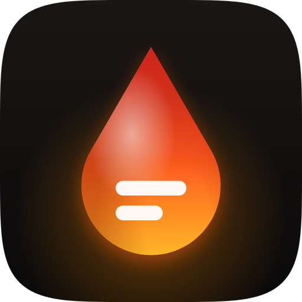
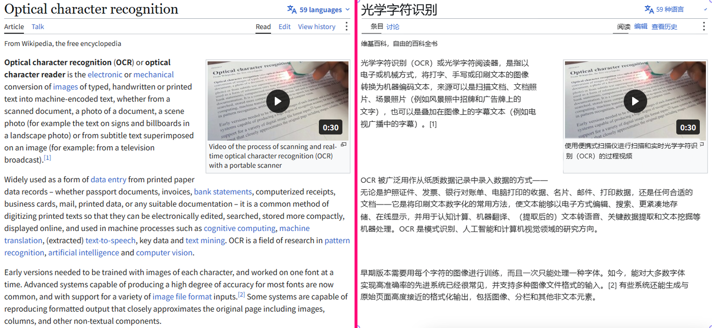
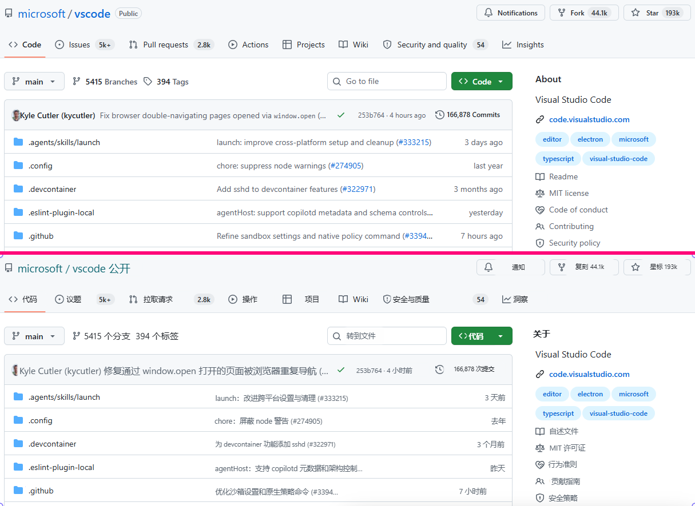
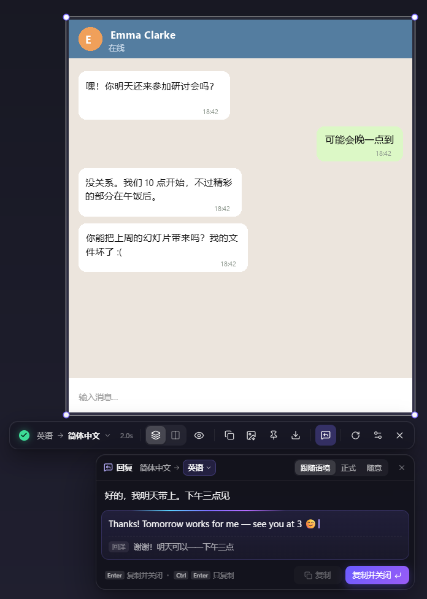
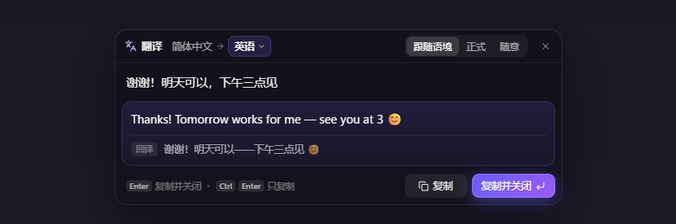
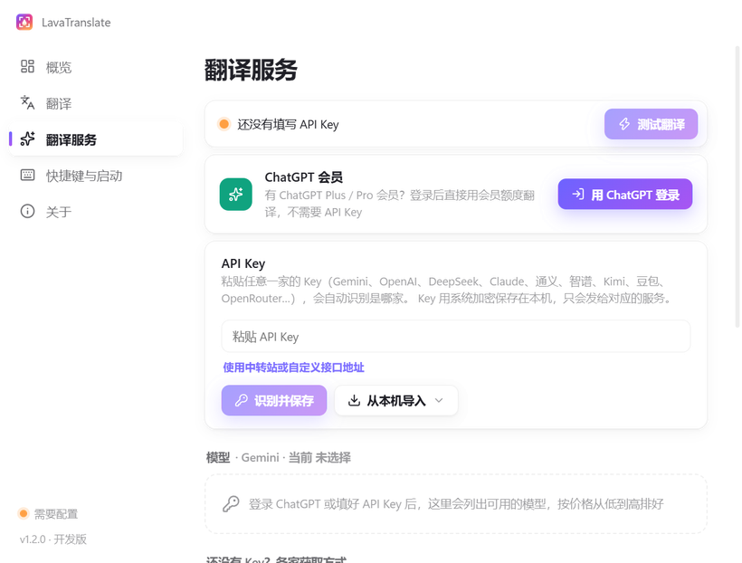

<p align="center">
  
</p>

<h1 align="center">LavaTranslate</h1>

<p align="center">
  <b>框选屏幕任意区域，译文按原来的排版直接盖在原文上。</b><br>
  看懂外语聊天后，还能用自己的语言直接回复。
</p>

<p align="center">
  <a href="https://github.com/chengcczzjj/LavaTranslate/releases/latest"></a>
  <a href="https://github.com/chengcczzjj/LavaTranslate/releases"></a>
</p>

<p align="center"><a href="README.md">English</a> · <b>简体中文</b></p>

<p align="center">Windows x64 · 安卓 arm64 · macOS（Apple Silicon）</p>

---



## 下载安装

| 平台 | 下载入口 | 第一次翻译 |
| --- | --- | --- |
| Windows 10/11 · x64 | [Windows 安装程序（.exe），v1.4.9](https://github.com/chengcczzjj/LavaTranslate/releases/download/v1.4.9/LavaTranslate-Setup-1.4.9.exe) | 按 **Win + 空格**，拖动框选即可识别文字。双击托盘图标可配置翻译服务。 |
| 安卓 10 及以上 · arm64 | [安卓安装包（APK），v1.4.7](https://github.com/chengcczzjj/LavaTranslate/releases/download/v1.4.7/LavaTranslate-Android-1.4.7.apk) | 打开应用，填写 API Key。安卓 11 及以上可在「无障碍」中启用 LavaTranslate，再点应用图标 →「翻译」。安卓 10 使用「截屏授权」。 |
| macOS · Apple Silicon（M 系列） | [Mac 安装包（.dmg），v1.4.9](https://github.com/chengcczzjj/LavaTranslate/releases/download/v1.4.9/LavaTranslate-Mac-1.4.9-arm64.dmg) | 从菜单栏图标打开「设置」，配置翻译服务。按 **Option + 空格**，按提示授予录屏权限后即可框选。 |

Windows 安装程序尚未签名。如果 SmartScreen 显示「未知发布者」，确认文件来自上方发布链接后，可点「更多信息 → 仍要运行」。

### 近期版本改动

- **Windows 和 Mac 1.4.9** 补齐 Mac 安装包、应用内检查更新和自动下载；Mac 下载后通过 Finder 手动安装。Windows 同步修复关闭自动更新后仍触发启动检查的问题。[版本说明](docs/releases/v1.4.9.md)

- **Windows 1.4.8** 加固输入法与键盘监听兼容性，异常时自动释放空格，并加入约 1.13 GB 离线翻译包的意向调查。安卓稳定版仍为 1.4.7。[版本说明](docs/releases/v1.4.8.md)
- **Windows 和安卓 1.4.7** 改进竖排漫画气泡排版，横排目标语言整行旋转 90°，自动均衡列数并优先保留完整单词。Windows 同时修正竖排 OCR、加速 CPU 识别；Mac 预览版源码同步桌面修复。[版本说明](docs/releases/v1.4.7.md)
- **Windows 1.4.6** 修复了截图后必须再点击一次才能用空格滚动的问题。现在只有真正开始翻译时才显示翻译进度。[版本说明](docs/releases/v1.4.6.md)
- **Windows 1.4.5** 支持关闭自动翻译、直接复制识别文字，并在选区已是目标语言时跳过翻译。按住空格可以滚动底层应用，选区边框保持可见。[版本说明](docs/releases/v1.4.5.md)
- **Windows 1.4.4** 安装包内置了主程序和 OCR 引擎所需的微软 VC++ x64 运行库，修复了部分电脑因运行库缺失或过旧而无法启动的问题。如果初始化仍然失败，弹窗会显示具体错误和日志位置。[版本说明](docs/releases/v1.4.4.md)
- **Windows 1.4.3** 将默认截图键改为 **Win + 空格**，按一次框选，连按两次翻译输入的文字。软件运行期间，这组键会用于翻译。习惯用它切换输入语言的话，可以在「设置 → 通用」中更换截图键。升级时旧默认键 **Alt + Q** 会自动迁移，其他自定义快捷键会保留。[版本说明](docs/releases/v1.4.3.md)
- **Windows 1.4.2** 修复了长译文盖住标题旁小字、相邻分栏或图标的问题。空间不足时显示省略号，鼠标悬停即可看全文，切换并排对照或复制也能拿到完整译文。[版本说明](docs/releases/v1.4.2.md)
- **Windows 和安卓 1.4.1** 支持为回复和输入翻译单独选择目标语言。Windows 上钉住的截图会排在屏幕左上角，可以钉译图，也可以钉原图。[版本说明](docs/releases/v1.4.1.md)

## Mac 版（Apple Silicon）

下载上方 DMG，将 LavaTranslate 拖入「应用程序」。1.4.9 起可在软件内检查更新并自动下载 ZIP；下载后点「查看更新包」，在 Finder 解压，退出软件后替换 Applications 中的旧应用。旧预览版需要先手动升级一次。当前 Mac 包使用 ad-hoc 签名，尚未经过 Apple 公证，仍遵循 macOS 安全检查。完整框选翻译与多屏对齐仍需在实际使用的 Mac 上验证。

要试用，请在 M 系列 Mac 上克隆本仓库，进入项目目录，使用原生 arm64 版 Node.js 22.18 或更高版本运行：

```bash
npm ci
npm run models
npm run dev
```

首次截图时，在「系统设置 → 隐私与安全 → 录屏与系统录音」（旧版系统称「屏幕录制」）中允许 Electron（开发模式）或 LavaTranslate（打包版）。若系统提示，完全退出后重新打开。只有「按住空格操作下层应用」需要额外授予「输入监控」权限。

在 Mac 上运行 `npm run pack:mac` 可生成本地 `.app`，运行 `npm run dist:mac` 可生成 DMG 和 ZIP。默认包采用本地临时签名，未经 Apple 公证；支持自动下载更新，安装通过 Finder 完成。[Mac 构建与排查指南](docs/MACOS.md)

## 有什么不一样

一般的截图翻译把结果列在另一个窗口里，你得一句句对回屏幕上去找。LavaTranslate 把每一行译文**放回原文所在的位置**：

- **位置、字号、颜色、粗细、对齐都和原文一致**：字号按笔画的实际高度推算，文字颜色能抵消 ClearType 的彩色边，粗体常规分得清，左对齐、居中、右对齐都保持，绕图排列的段落也保持原来的形状；
- **图标不会被盖掉**：被 OCR 误认成字符的箭头、星星、列表序号都保留可见；
- **模型会看截图**：文字识别在本地完成，再由支持看图的模型纠正识别错误、把折行的句子合成段落，代码、命令、网址、@用户名、品牌名保持原样不翻；
- **译文逐段出现**。Windows 本地文字识别优先使用 DirectML，可回退到 CPU。Mac 版使用 CPU 识别。



## 回复助手

看懂了对方的消息，接下来就是回复。



- 截图是**聊天、私信、评论、邮件**这类对话时，翻译完成后工具条下方会自动出现回复框；任何时候按 <kbd>R</kbd> 也能打开；
- 用自己的语言输入，停顿片刻就开始翻译。「自动」时译成截图里识别出的对方语言；也可以在语言菜单里手动选任意语言（这张截图里一直有效，换一张截图回到自动）；
- 语气可选「跟随语境 / 正式 / 随意」，模型会参照屏幕上的对话决定措辞和称呼；
- 译文下方附**回译**：再翻回你的语言，不懂对方的语言也能确认意思没变；
- <kbd>Enter</kbd> 复制并关闭，回到聊天软件就能粘贴。**Ctrl + Enter**（Mac 上用 **Command + Enter**）复制并保留回复框。**Shift + Enter** 换行，**↑ / ↓** 翻看之前的回复。

<br clear="right">

## 输入文字翻译

**连按两次截图快捷键**就能直接输入文字翻译。默认是 Windows 上的 **Win + 空格** 和 Mac 上的 **Option + 空格**。停顿约两秒后开始翻译，也可以按 <kbd>Enter</kbd> 立即翻译。「自动」会在界面语言和上次使用的外语之间互译。想固定目标语言，可以从菜单里选，之后输入的文字都会译成它，下次打开还记得。译好后按 <kbd>Enter</kbd> 即可复制并关闭。



## 安卓版

从[下载安装](#下载安装)一节获取 APK，打开应用后按对应安卓版本的提示设置。

- **开一次，一直可用**（Android 11 起，推荐）：在系统「无障碍」里打开一次 LavaTranslate，之后不需要悬浮窗权限、不用每次授权截屏、没有常驻通知，开机自动就绪；
- **点图标就是悬浮面板**：点桌面上的 LavaTranslate 图标，屏幕顶部滑下一条毛玻璃横条（翻译 / 回复 / 设置，右边关闭），可上下拖动；下拉快捷开关「翻译屏幕」「快捷回复」也能打开；
- **整屏翻译**：点「翻译」，横条收起、屏幕边上出现小胶囊，整屏译文按原来的位置、字号盖在原文上；**照常滑动、点按应用**——译文不挡操作，手指一碰就让开，**应用滚动或换页停下后自动翻译新的一屏**（只是点了一下、屏幕没变，就把译文原样放回来）；翻过的内容有缓存、立刻出现；
- **小胶囊**（始终在译文上面）：**按住「对比」（眼睛）看原文**、松开回到译文；「回复」打开回复框；「退出」回到面板；译文让开时第一个按钮变成「翻译」，点一下立刻重翻；
- **回复助手**：用自己的语言写，自动译成屏幕上对话的语言并附回译；面板上的「回复」（或下拉快捷开关「快捷回复」）可以直接输入文字翻译；
- 普通界面直接读屏幕上的文字（更快、更准），游戏、图片里的字在手机本地做文字识别；只有屏幕内容会发给你配置的翻译服务；
- **省电**：不翻译时什么都不运行——不截屏、不联网、不接收界面事件；翻译界面和文字识别模型用时才载入，用完 3 分钟后（或关屏时）释放；
- **备用方式**：Android 10，或不想开无障碍时，可以改用「截屏授权」：悬浮窗里的悬浮球 + 系统的屏幕共享授权（锁屏或几分钟不用后要重新点一次授权，有常驻通知）；
- **应用内更新**：发现新版本会提示，Wi-Fi 下自动下载好，点一下安装。

## 配置：用 ChatGPT 登录，或填任意一家的 API Key

Windows 上双击托盘图标，Mac 上点菜单栏图标并选择「设置」。打开「翻译服务」，登录自己的账号或填写自己的 Key。桌面界面默认跟随系统语言，也可以在「设置 → 通用」中从 12 种界面语言里选择。

- **ChatGPT Plus / Pro 会员**：点「**用 ChatGPT 登录**」，翻译消耗会员额度，不需要 API Key。这是 OpenAI 为开源软件提供的官方「使用 ChatGPT 会员额度」登录方式；
- **任意一家的 API Key**：粘贴进来点「**识别并保存**」。软件先按 Key 的格式识别（`AIza…` 是 Gemini、`sk-ant-…` 是 Claude、`sk-or-…` 是 OpenRouter、`sk-proj-…` 是 OpenAI，智谱、豆包也有固定格式），格式相同的几家（DeepSeek、OpenAI、通义、Kimi）会实际连一下来确认，还识别不出来就让你选。中转站、本地模型再填一下接口地址。

然后选一个模型（按每千次截图的估算费用从低到高排），点「**测试翻译**」即可。填过的服务都会保存，以小标签列出，点一下就能切换；页面底部有各家获取 Key 的步骤和直达链接。



**支持的服务商**

| 服务商 | 获取 Key | 推荐的快模型 | 说明 |
| --- | --- | --- | --- |
| ChatGPT 会员 | 登录即可，不需要 Key | `gpt-6-luna` | 消耗 Plus / Pro 会员额度 |
| Gemini | [Google AI Studio](https://aistudio.google.com/apikey) | `gemini-3.5-flash-lite` | 有免费额度，免费额度内的数据可能被 Google 使用；国内需要代理 |
| OpenAI | [OpenAI Platform](https://platform.openai.com/api-keys) | `gpt-6-luna`、`gpt-5-mini` | ChatGPT 会员不包含 API 额度 |
| DeepSeek | [DeepSeek 开放平台](https://platform.deepseek.com/api_keys) | `deepseek-flash` | 能看图，首字约 1 秒，非高峰时段半价，国内直连 |
| 通义千问 | [阿里云百炼](https://bailian.console.aliyun.com/?tab=model#/api-key) | `qwen3.8-flash` | 新用户有免费额度，国内直连 |
| 智谱 GLM | [智谱开放平台](https://bigmodel.cn/usercenter/proj-mgmt/apikeys) | `glm-4.6v-flash` | 免费且能看图（同一时间只处理一个请求） |
| Kimi | [Kimi 开放平台](https://platform.kimi.com/console/api-keys) | | 国内直连 |
| 豆包 | [火山方舟](https://console.volcengine.com/ark/region:ark+cn-beijing/apiKey) | `doubao-seed-2.0-mini` | 新用户有免费额度，国内直连 |
| Claude | [Claude Console](https://platform.claude.com/settings/keys) | `claude-haiku-4-5` | 只能用 API Key：Anthropic 不允许第三方软件使用 Claude Pro / Max 会员登录；通过 Anthropic 提供的 OpenAI 兼容接口调用 |
| OpenRouter | [OpenRouter](https://openrouter.ai/settings/keys) | | 一个 Key 用遍各家模型 |
| 自定义 | — | | 任何兼容 OpenAI 接口的服务：中转站、Ollama、LM Studio 等 |

软件会让所有模型跳过「思考」直接作答（按各家自己的参数，不支持时自动退回），DeepSeek V4 Flash、GLM Flash 这类模型因此快 2–4 倍。不能看图的模型也能用，只是只根据 OCR 文字翻译，没法纠正识别错误。在「自定义」里点「**从本机导入**」，可以直接用 Codex 或 CC Switch 里现成的 Key。

## 快捷键

| 桌面操作 | Windows | macOS |
| --- | --- | --- |
| 开始截图 | **Win + 空格**，或单击托盘图标 | **Option + 空格**，或点菜单栏图标 →「截图翻译」 |
| 输入文字翻译 | 连按两次截图快捷键 | 连按两次截图快捷键 |
| 打开设置 | 双击托盘图标 | 菜单栏图标 →「设置」，或在应用内按 **⌘ ,** |
| 按住查看原文 | Alt | Option |
| 复制全部译文 / 原文 | Ctrl + C / Alt + C | ⌘ C / Option + C |
| 复制译图 / 保存译图 | Ctrl + Shift + C / Ctrl + S | ⌘ Shift C / ⌘ S |
| 钉译图 / 钉原图 | F3 / Alt + F3 | ⌘ T / Option + ⌘ T |
| 重新翻译选区 | Ctrl + R | ⌘ R |

两个桌面平台都可以拖动框选，也可以单击选中鼠标下的窗口。拖动选区或边缘手柄可以移动、缩放选区。按住**空格**可操作下方应用，松开后重新截取同一区域。

- **Tab** 切换原位覆盖和并排对照，**R** 打开回复助手。
- 单击一段译文可复制该段，**Enter** 复制全部译文并关闭。双击选区可复制当前图片并关闭，同时按住 **Alt**（Mac 上用 **Option**）可复制原图。
- 钉图可拖动、滚轮缩放，双击关闭。需要一直显示在其他窗口上方时，点钉图工具条上的「置顶」。
- 右键或按 **Esc** 退出截图。

## 隐私

- 文字识别在设备本地完成。桌面版把选区图片和识别出的文字发送给你配置的翻译服务，安卓版整屏翻译使用当前屏幕。回复和输入翻译也会发送你输入的文字。最近用过的回复保存在本机，方便用方向键调出。
- **Windows** 在系统加密可用时，通过 Electron 的 `safeStorage`（DPAPI）加密 API Key 和 ChatGPT 登录令牌。**安卓**使用 Android Keystore 中的密钥加密 API Key。
- **Mac 版**将凭据以明文保存在本机的 `settings.json` 中。文件权限为 `0600`，同一 macOS 账号下运行的程序仍可读取，设置界面会对 Key 打码。若从使用钥匙串的旧预览版升级，请重新填写一次 Key。请勿分享这个配置文件。

## 自动更新

**Windows 安装版**

- 软件在**启动 20 秒后检查一次，之后每 4 小时检查一次**本仓库的 Releases。也可从托盘菜单或「设置 → 关于」中选择「检查更新」。
- 发现新版本会在后台下载，只下载安装包里有变化的部分；
- 下载完成后弹出通知，托盘菜单和「关于」页出现「**重启并更新到 vX**」，点一下立即更新；不点的话，下次退出软件时自动安装；
- 设置窗口左下角显示当前版本和更新状态，点它直接跳到「关于」页；在「关于」页可以关闭自动更新。

**安卓版**通过独立的更新索引检查新 APK，可在应用内安装。**Mac 版**可在软件内检查并自动下载 ZIP，退出后在 Finder 中解压替换应用。旧预览版需先手动升级一次到 1.4.9。

## 常见问题

**能用 ChatGPT / Codex 会员吗？**
ChatGPT Plus / Pro 可以：设置 → 翻译服务 →「**用 ChatGPT 登录**」，翻译消耗会员额度。Claude Pro / Max 不行——Anthropic 不允许第三方软件使用 claude.ai 登录，Claude 需要 API Key。

**翻译比较慢？**
换一个标着「快」的小模型。推理型模型写之前要先思考好几秒。

**支持哪些语言？**
本地 OCR 能识别中文、日文、英文等拉丁字母语言、俄文等；OCR 认不出的文字（比如韩文）由能看图的模型直接从截图里读出来。译成什么语言，在工具条上随时切换。

**Windows 版怎么卸载？**
Windows 设置 → 应用 → LavaTranslate → 卸载。

## 从源码构建

需要 Windows 10/11 x64、Node.js 22 以上；有 Python 3 和 `onnx` 时会顺便给 OCR 模型打加速补丁（可选）。Windows 打包会自动从微软下载并校验固定版本的 VC++ x64 运行库，放在应用目录随包分发；首次打包需要联网，缓存后可离线打包。离线准备和故障排查见 [开发文档](docs/DEVELOPMENT.md#windows-运行库与启动诊断)。

```bash
npm install
npm run models   # 下载 PP-OCRv6 模型（约 30 MB）
npm run dev      # 开发模式运行
npm run dist     # 打包 NSIS 安装程序到 dist/
```

以上命令用于 Windows 安装包。Apple Silicon 用户请按 [Mac 构建步骤](docs/MACOS.md)构建。安卓编译环境、排版引擎和测试命令见[开发文档](docs/DEVELOPMENT.md)。

桌面版使用 Electron、React 和 Motion，通过 ONNX Runtime 运行本地的 [PaddleOCR PP-OCRv6](https://github.com/PaddlePaddle/PaddleOCR) 模型。

## 许可证

[MIT](LICENSE) © 2026 chengcczzjj

---

<p align="center">问题和建议欢迎提 <a href="https://github.com/chengcczzjj/LavaTranslate/issues">Issues</a></p>
